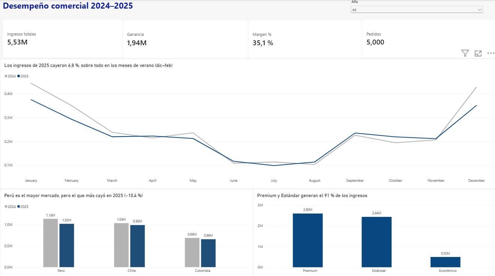
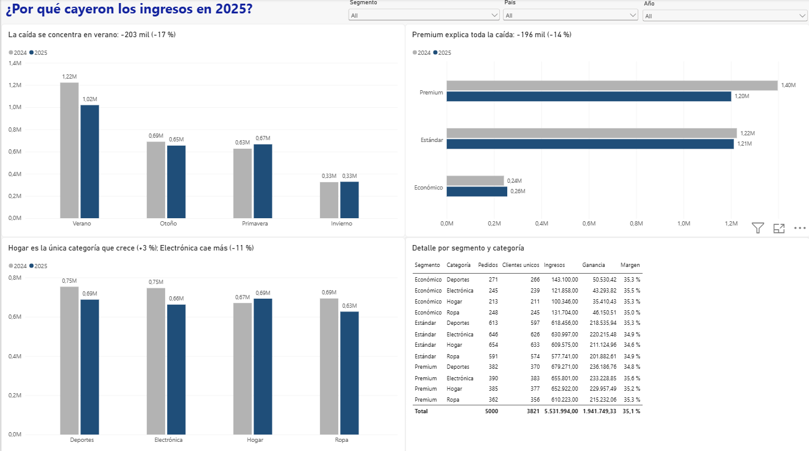

# Dashboard de desempeño comercial 2024–2025 | Power BI

Dashboard interactivo en **Power BI** para **Andes Retail Group**, una empresa de retail con operaciones en Perú, Chile y Colombia. Responde una pregunta concreta de la dirección: **¿por qué cayeron los ingresos en 2025 y qué se puede hacer?**

**Resultado principal:** los ingresos cayeron **6,8 %** (−195 mil) con un margen estable de **35,1 %**. La caída se concentra en los **clientes Premium durante el verano** (diciembre a febrero): **−168 mil**.

> Proyecto 9 del bootcamp de Análisis de Datos de TripleTen (Sprint 10), aprobado en la primera revisión.

---

## Vista previa

### Vista General: ¿cómo está el negocio?


### Vista Detalle: ¿por qué cayeron los ingresos?


---

## Contexto y preguntas de negocio

La información de ventas estaba en datos transaccionales, sin una visión que permitiera responder preguntas estratégicas. El dashboard responde:

1. ¿Cómo evolucionó el ingreso total entre 2024 y 2025?
2. ¿Qué segmentos de clientes aportan más ingreso y rentabilidad?
3. ¿Qué categorías de producto tienen mayor impacto?
4. ¿Hay diferencias relevantes entre países?
5. ¿Qué patrones temporales se observan durante el año?
6. ¿Dónde hay oportunidades de mejora comercial?

## Dataset

`data/Andes_Retail_Group_2024_2025.xlsx`: **5.000 pedidos** del 1 de enero de 2024 al 31 de diciembre de 2025, con 12 columnas. Una fila = un pedido.

| Columna | Descripción |
| --- | --- |
| ID_Pedido, Fecha_Pedido | Identificador y fecha del pedido |
| Estación | Temporada del hemisferio sur (Verano = dic–feb) |
| ID_Cliente, Segmento_Cliente | Cliente y segmento (Premium, Estándar, Económico) |
| País, Región | Perú, Chile, Colombia; Norte, Centro, Sur |
| Categoría_Producto | Electrónica, Ropa, Deportes, Hogar |
| Unidades_Vendidas, Precio_Unitario | Cantidad y precio por unidad |
| Ingresos, Costo | Venta total (precio × unidades) y costo asociado |

Calidad: 0 nulos, 0 duplicados, `Ingresos = Precio × Unidades` en todas las filas y la estación coincide con el mes en todos los pedidos.

## Herramientas

- **Power BI Desktop**: Power Query, modelo de datos, DAX y visualización
- **Modelo narrativo SCQA**: Situación, Complicación, Pregunta, Respuesta
- **Python (pandas)**: para validar de forma independiente las cifras del dashboard

## Proceso

### 1. Conexión y exploración
Carga del Excel con *Transform Data* para revisar los datos antes de llevarlos al informe. Revisión de tipos con **Column quality** y **Column profile** sobre el dataset completo (no solo las primeras 1.000 filas): 100 % de valores válidos en las 12 columnas.

### 2. Preparación de datos (Power Query)
- Fecha de pedido con configuración regional **español (Ecuador)**, para que el formato quede fijado en el archivo y no dependa de la computadora que lo abra.
- Validación de tipos numéricos: enteros para unidades, precio e ingresos; decimal para costo.
- Columna condicional **`Nivel_Venta`**: *Venta Alta* si `Ingresos ≥ 1000`, *Venta Baja* en otro caso. Resultado: 2.208 ventas altas y 2.792 bajas. Se comprobó el caso límite: los 3 pedidos con ingresos exactamente de 1.000 quedan como *Venta Alta*.

### 3. Modelo y medidas DAX
Columna calculada para separar los años en filtros y leyendas:

```DAX
Año = YEAR(Ventas[Fecha_Pedido])
```

Medidas reutilizables en todo el dashboard:

```DAX
Ingresos totales = SUM(Ventas[Ingresos])
Costo total      = SUM(Ventas[Costo])
Ganancia         = [Ingresos totales] - [Costo total]
Margen %         = DIVIDE([Ganancia], [Ingresos totales])
Pedidos          = DISTINCTCOUNT(Ventas[ID_Pedido])
Clientes         = DISTINCTCOUNT(Ventas[ID_Cliente])
Pedidos (texto)  = FORMAT([Pedidos], "#,0")
```

- `Ganancia` y `Margen %` se construyen sobre otras medidas: si cambia una, todo se actualiza.
- `DIVIDE` evita errores cuando un filtro deja los ingresos en cero.
- `Clientes` usa `DISTINCTCOUNT`: el total (3.821) no es la suma de cada año, porque hay clientes que compraron en ambos.
- `Pedidos (texto)` muestra el número completo en la tarjeta KPI (5,000 en lugar de "5K").

### 4. Diseño del dashboard

**Vista General**, para entender el negocio en segundos:
- 4 KPIs: ingresos, ganancia, margen y pedidos.
- Línea de ingresos por mes con 2024 y 2025 superpuestos: muestra la tendencia y la estacionalidad.
- Columnas por país y año, y columnas por segmento.

**Vista Detalle**, para diagnosticar la causa:
- Ingresos por estación, por segmento y por categoría, comparando 2024 contra 2025.
- Tabla por segmento y categoría con pedidos, clientes únicos, ingresos, ganancia y margen.

**Decisiones de diseño:**
- **Títulos que comunican la conclusión**, no solo el tema (por ejemplo, *"Premium explica toda la caída: −196 mil (−14 %)"*).
- **Colores con significado, iguales en todo el dashboard:** gris `#B3B3B3` para 2024 (referencia) y azul `#1F4E79` para 2025 (año analizado).
- Etiquetas de datos en las barras, sin subtítulos automáticos y con la leyenda siempre arriba a la izquierda.

**Filtros e interacciones:**
- Segmentador de **Año sincronizado** entre las dos páginas.
- Segmentadores de **País** y **Segmento** en la Vista Detalle.
- Interacciones configuradas para que un clic en un segmento **filtre** los demás gráficos, en lugar de solo resaltarlos.

### 5. Narrativa SCQA
El análisis completo, con la narrativa de cada vista y el mensaje ejecutivo para Slack, está en el notebook [`notebook/proyecto9_dashboard_desempeno_comercial.ipynb`](notebook/proyecto9_dashboard_desempeno_comercial.ipynb).

## Hallazgos principales

| Indicador | 2024 | 2025 | Variación |
| --- | --- | --- | --- |
| Ingresos | 2,86M | 2,67M | **−6,8 %** |
| Ganancia | 1,01M | 0,94M | −6,9 % |
| Margen | 35,1 % | 35,1 % | sin cambio |
| Pedidos | 2.550 | 2.450 | −3,9 % |

1. **No es un problema de rentabilidad:** el margen se mantiene en 35,1 % ambos años y en todas las combinaciones de segmento y categoría (entre 34,6 % y 35,6 %).
2. **La caída está en la temporada alta:** el verano genera el 40 % de los ingresos, y ahí los ingresos bajaron 203 mil (−17 %), más que la caída total del año. Primavera incluso creció.
3. **El origen son los clientes Premium:** su ingreso cayó 196 mil (−14 %); Estándar se mantuvo y Económico creció. En verano, Premium pasó de 0,61M a 0,44M (−168 mil).
4. **No es un problema de producto:** la caída es parecida en Deportes, Electrónica y Ropa, y Hogar es la única categoría que crece (+3 %).
5. **Por país,** Perú es el mayor mercado y el que más cayó (−10,4 %).

## Recomendación

Lanzar una **campaña de retención y reactivación de clientes Premium antes del próximo verano (noviembre)**, priorizando **Chile y Perú**, donde Premium cayó más. En paralelo, investigar por qué estos clientes compraron menos en el verano de 2025: competencia, disponibilidad de stock o campañas.

## Estructura del repositorio

```
dashboard-desempeno-comercial-powerbi/
├── README.md
├── dashboard/
│   └── proyecto9_stefan_loosveld.pbix     # Dashboard de Power BI
├── data/
│   └── Andes_Retail_Group_2024_2025.xlsx  # Dataset original
├── images/
│   ├── vista_general.png
│   └── vista_detalle.png
└── notebook/
    └── proyecto9_dashboard_desempeno_comercial.ipynb  # Planificación y narrativa SCQA
```

## Cómo abrir el dashboard

1. Instala [Power BI Desktop](https://www.microsoft.com/es-es/power-platform/products/power-bi/desktop) (gratis, Windows).
2. Descarga `dashboard/proyecto9_stefan_loosveld.pbix` y ábrelo.
3. Los datos están incluidos en el archivo: no hace falta conectar el Excel para explorarlo.

## Lo que aprendí

- Preparar datos en Power Query de forma reproducible, sin depender de la configuración regional del equipo.
- Elegir la agregación correcta: suma para lo que se acumula (ingresos, pedidos) y promedio o ratio para tasas (margen).
- Diseñar con jerarquía visual: una vista que dice *qué pasó* y otra que explica *por qué*.
- Escribir títulos que digan la conclusión y verificar cada afirmación contra los datos.
- Contar el hallazgo con SCQA y resumirlo en un mensaje ejecutivo breve.

---

**Autor:** Stefan Loosveld · [GitHub](https://github.com/stefanloosveld)
